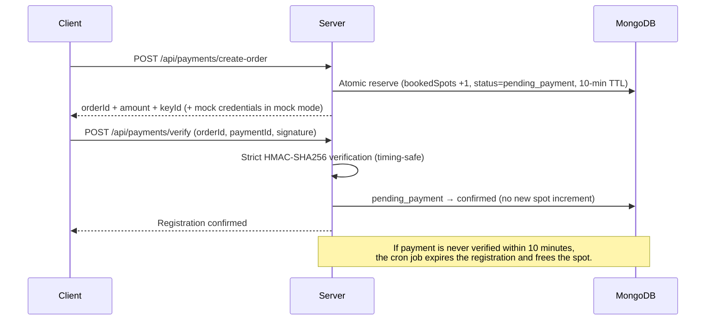

# Feedants Competition Details — Full-Stack Technical Assignment

A production-quality, full-stack **Competition Details module** built to replicate the **Feedants Classical Dance** mobile interface with pixel-accurate fidelity, full dynamic data synchronization from MongoDB, multi-language localization (`ENG` / `हिंदी`), resilient concurrency handling for spot bookings, and real-time state management.

---

## 📸 Visual Fidelity & Dynamic Feature Mapping

Every section of the screen is dynamically driven from MongoDB and the Express backend:

| Screen Section | Backend Dynamic Attributes | Interactive Capabilities |
| :--- | :--- | :--- |
| **Top Header** | `title`, `titleHindi`, `tags`, `tagsHindi`, `userState.isRegistered` | Go back, Language switch (`ENG` \| `हिंदी`), Registered badge |
| **Competition Summary** | `prizePool` (₹1,500), `entryFee` (₹99), `totalSpots` (20), `bookedSpots` (1), `availableSpots` (19) | Dynamic spots counter (`Only 19 spots left`), fill progress ratio bar |
| **Judge Card** | `judge.name`, `judge.profession`, `judge.experience`, `judge.profileImage`, `judge.introVideoUrl` | **Intro Video** button launches in-app modal video playback |
| **Live Countdown** | `registrationEnd` (UTC ISO timestamp) | 1-second interval ticking countdown (`01d : 06h : 28m : 32s`), timezone-resilient, auto-stops at zero |
| **Important Dates** | `registrationEnd`, `submissionStart`, `submissionEnd`, `resultDate` | 2x2 grid with formatted local date & time strings |
| **Previous Winners** | `winners[]` (Name, rank position, profile photo, performance video URL) | Horizontal carousel; clicking any winner plays their performance video |
| **Competition Tabs** | `description`, `judgingParameters[]`, `rules[]`, `eligibility[]` | 3 Tabs: **About** (with *View more* toggle), **Judging** (with % weight bars), **Rules & Eligibility** |
| **Rewards Breakdown** | `rewards[]` (Positions 1 to 6, amounts ₹600 to ₹50, certificates) | Ranked tiered prize breakdown with trophy and medal badges |
| **Disclaimer** | `disclaimer`, `disclaimerHindi` | Alert box with conditional judging eligibility policy |
| **Payment & Security** | `refundPolicy`, Razorpay integration | Clickable **How will you receive prize money?** modal, **Refund Policy** modal, Razorpay trust badge |
| **Referrals** | `user.referralCode` | Instant 1-tap clipboard copying of personalized invite code |
| **Participant Reviews** | `Review` collection (Rating, comments, avatars) | Displays aggregate score (4.9/5) and opens interactive review submission modal |
| **Bottom Action Bar** | Entry fee, `userState.isGuest`, `userState.isRegistered`, `userState.hasSubmitted`, `status` | Dynamic button: *Login to Participate*, *Register Now - ₹99*, *Upload Submission*, or *Submission Uploaded ✓* |

---

## 🛠 Tech Stack (MERN Architecture)

### Frontend (Mobile & Web)
* **Framework**: React Native with **Expo SDK 57**
* **File Extension**: **Strictly `.jsx`** across all components, screens, contexts, and navigators
* **State Management**: React Context API (`AuthContext`, `CompetitionContext`, `LanguageContext`)
* **Navigation**: React Navigation Bottom Tabs (`@react-navigation/bottom-tabs`, `@react-navigation/native`)
* **Styling**: StyleSheet matching Feedants branding (`#005C53` deep teal, `#EAF7F5` mint countdown background)
* **Storage**: `@react-native-async-storage/async-storage` for JWT persistence
* **Media / Documents**: `expo-image-picker`, `expo-document-picker`, `expo-clipboard`

### Backend
* **Runtime**: Node.js v18+ / v22+
* **Framework**: Express.js
* **Architecture**: Clean 4-tier layer: **Routes → Controllers → Services → Models**
* **Database**: MongoDB with Mongoose ODM
* **Authentication**: JWT (JSON Web Tokens) with `bcryptjs` password hashing
* **File Uploads**: `multer` with MIME-type and 500MB size validation
* **Payment Abstraction**: Razorpay order creation and HMAC verification simulator

---

## 🛡 Concurrency & Race Condition Architecture

A critical requirement of competition platforms is ensuring **no overbooking occurs** when multiple users attempt to register simultaneously for limited spots (e.g. only 1 spot remaining for 20 total spots).

### 1. Conditional Atomic Reservation (`$expr`)
Instead of a vulnerable `read -> check -> increment` sequence, the reservation executes in a single atomic database operation:

```javascript
// src/services/registrationService.js
const updatedCompetition = await Competition.findOneAndUpdate(
  {
    _id: competitionId,
    $expr: {
      $and: [
        { $lt: ['$bookedSpots', '$totalSpots'] },
        { $gt: ['$registerBeforeAt', now] }
      ]
    }
  },
  { $inc: { bookedSpots: 1 } },
  { returnDocument: 'after' }
);

if (!updatedCompetition) {
  throw new CompetitionFullError('All spots for this competition have been booked');
}
```

### 2. Compound Unique Index for Deduplication
To prevent duplicate registrations or parallel requests from the same user:
```javascript
// src/models/Registration.js
registrationSchema.index({ user: 1, competition: 1 }, { unique: true });
```

### 3. Automatic Rollback Mechanism
If the registration document insertion fails or encounters a duplicate key error (`E11000`), the booked spot count is immediately decremented back:
```javascript
catch (error) {
  await Competition.findByIdAndUpdate(competitionId, { $inc: { bookedSpots: -1 } });
  if (error.code === 11000) {
    throw new DuplicateRegistrationError('You are already registered for this competition');
  }
  throw error;
}
```

---

## ⚙️ Environment Variables Configuration

### Backend (`backend/.env`)
```env
PORT=5000
NODE_ENV=development
MONGO_URI=mongodb://127.0.0.1:27017/feedants_competition
JWT_SECRET=super_secret_feedants_jwt_key_2026_dev_prod
JWT_EXPIRE=30d
RAZORPAY_KEY_ID=rzp_test_DUMMY_KEY_REPLACE_ME
RAZORPAY_KEY_SECRET=DUMMY_SECRET_REPLACE_ME
CLIENT_URL=http://localhost:8081
```

### Frontend (`frontend/.env`)
```env
# For Web & iOS Simulator:
EXPO_PUBLIC_API_URL=http://localhost:5000/api

# For Android Studio Emulator (uncomment if using emulator):
# EXPO_PUBLIC_API_URL=http://10.0.2.2:5000/api

# For Physical Smartphone with Expo Go (uncomment and set your PC IP):
# EXPO_PUBLIC_API_URL=http://192.168.1.100:5000/api

EXPO_PUBLIC_RAZORPAY_KEY_ID=rzp_test_DUMMY_KEY_REPLACE_ME
```

---

## 🚀 How to Run the Application

### 1. Start the Backend
Open a terminal in the `backend` folder:
```bash
cd backend
npm install
npm run seed     # Seeds database with Feedants Classical Dance data
npm test         # Runs all 13 automated tests
npm run dev      # Starts Express API server with hot-reload (Port 5000)
```

### 2. Start the Frontend
Open a second terminal in the `frontend` folder:
```bash
cd frontend
npm install
npm run web      # Starts app in Web browser (http://localhost:8081)
# or
npm run dev      # Starts interactive Expo CLI (Scan QR code in Expo Go app)
# or
npm run android  # Starts in Android Studio Emulator
```

---

## 👥 Demo Test Accounts

| Name | Email | Password | Initial State | Purpose |
| :--- | :--- | :--- | :--- | :--- |
| **Priya Sharma** | `priya@feedants.com` | `password123` | **Registered** | Tests viewing registered state, uploading performance submissions, and viewing submission confirmation. |
| **Rohan Verma** | `rohan@feedants.com` | `password123` | **Unregistered** | Tests interactive Razorpay payment simulation, instant spot decrement (19 → 18), and dynamic badge change. |
| **Admin User** | `admin@feedants.com` | `password123` | **Admin** | Management & review privileges. |
| **Guest Mode** | *(None)* | *(None)* | **Unauthenticated** | Tests *Login to Participate* flow and in-app modal login. |

---

## 📡 API Reference

### Competitions
* `GET /api/competitions/feedants-dance` — Get featured competition with computed status, spots, and user state
* `GET /api/competitions/:id` — Get competition details by ID
* `GET /api/competitions/:id/winners` — Get ranked previous winners with performance video links
* `GET /api/competitions/:id/rewards` — Get reward prize tiers

### Registrations & Payments
* `POST /api/payments/create-order` — Reserve a spot (10-min hold) and create a Razorpay order for the entry fee
* `POST /api/payments/verify` — Verify payment signature and confirm the pending registration
* `POST /api/payments/webhook` — Razorpay webhook (HMAC-verified with raw body) for payment reconciliation
* `POST /api/competitions/:id/register` — Server-controlled reserve endpoint (atomic concurrency checks)
* `GET /api/competitions/:id/registration` — Get current user's registration state for a competition
* `DELETE /api/competitions/:id/registration` — Cancel a registration and free the reserved spot

### Submissions
* `POST /api/competitions/:id/submission` — Upload multipart video/image entry with title and style notes
* `GET /api/competitions/:id/submission` — Retrieve current user's submission metadata

### Reviews & Referrals
* `GET /api/reviews` — Get all participant reviews
* `POST /api/reviews` — Submit participant review
* `GET /api/referrals/my-code` — Retrieve user's referral code and cashback stats

### Auth
* `POST /api/auth/register` — Create account (returns access token + refresh token)
* `POST /api/auth/login` — Login (returns access token + refresh token)
* `POST /api/auth/refresh` — Exchange a refresh token for a new access token
* `GET /api/auth/me` — Get current user profile (protected)
* `POST /api/auth/logout` — Logout (protected)

---

## 🧾 Registration Lifecycle (Two-Phase, Server-Controlled)

Registration is a **two-phase flow** so that a spot is never permanently consumed by an abandoned payment:



* **Phase 1 — Reserve**: `POST /api/payments/create-order` atomically increments `bookedSpots` and creates a `pending_payment` registration with a 10-minute expiry. The client **cannot** supply status, paymentId, orderId, or amount — everything is server-controlled.
* **Phase 2 — Confirm**: `POST /api/payments/verify` verifies the Razorpay HMAC signature and flips the registration to `confirmed` without incrementing spots again.
* **Expiry**: A `node-cron` job runs every minute (`src/jobs/registrationExpiryJob.js`) and expires stale `pending_payment` registrations inside a transaction (with an atomic fallback), freeing the reserved spot.
* **Status enum**: `pending_payment → confirmed | cancelled | expired`.

---

## 🔐 Environment Variables Reference

| Variable | Location | Purpose |
| :--- | :--- | :--- |
| `PORT` | backend | Express server port (default `5000`) |
| `NODE_ENV` | backend | `development` / `production` / `test` (cron job disabled in `test`) |
| `MONGO_URI` | backend | MongoDB connection string (Atlas or local) |
| `JWT_SECRET` | backend | Signs short-lived access tokens |
| `JWT_EXPIRE` | backend | Access token lifetime (default `30d`) |
| `JWT_REFRESH_SECRET` | backend | Signs long-lived refresh tokens (30 days, `type: 'refresh'` claim) |
| `RAZORPAY_KEY_ID` / `RAZORPAY_KEY_SECRET` | backend | Razorpay API credentials for real order creation |
| `RAZORPAY_WEBHOOK_SECRET` | backend | Verifies `x-razorpay-signature` on `POST /api/payments/webhook` (raw body) |
| `RAZORPAY_MOCK` | backend | **`true` = mock payment mode** — orders and payments are simulated locally with HMAC-signed mock credentials, no Razorpay network calls. Ideal for dev/demo and required for the automated tests. **Must NEVER be `true` in production.** |
| `CLIENT_URL` | backend | Allowed CORS origin for the frontend |
| `EXPO_PUBLIC_API_URL` | frontend | Base URL of the backend API |
| `EXPO_PUBLIC_RAZORPAY_KEY_ID` | frontend | Razorpay key used by the mobile checkout SDK in real mode |

### Media storage
Uploaded submissions are stored on **local disk** in `backend/uploads/` via `multer` (50 MB limit, MIME-type validation). For production, swap the disk storage engine for S3/GCS — only `src/middleware/upload.js` needs to change.

---

## 📐 Assumptions, Technical Decisions & Trade-offs

### Assumptions
* One featured competition ("Feedants Classical Dance") is seeded and surfaced by `GET /api/competitions/feedants-dance`; the frontend falls back to the first competition in the list.
* Entry fee is charged in INR via Razorpay; refunds are policy-only (no automated refund API call).
* Referral cashback (₹10 per successful registration) is tracked via `Referral` / `ReferralEvent` documents.
* Reviews are public to read; only authenticated users can write them.
* The mobile client may have a skewed device clock, so all countdowns are anchored to server time (`serverTime` offset).

### Technical decisions
* **Atomic `$expr` reservation + two-phase payment** — guarantees no overbooking and no permanently-lost spots, verified by a 10-way parallel concurrency test.
* **Strict HMAC verification with `timingSafeEqual`** — payment signatures are never compared with `===`, and verification is enforced even in mock mode (mock credentials are signed with the real secret).
* **Refresh token rotation** — access + refresh tokens are issued on login/register; `POST /api/auth/refresh` exchanges a refresh token (with `type: 'refresh'` claim check) for a new access token.
* **Server-computed competition status** — `getComputedStatus()` derives `upcoming / registration_open / registration_closed / submission_open / submission_closed / results_declared` from timestamps and spot counts, so clients can never disagree with the server about state.
* **Raw-body webhook verification** — `express.json({ verify })` captures the raw body for `/api/payments/webhook` so Razorpay's HMAC can be validated byte-for-byte.

### Trade-offs
* **Local disk uploads** — simple and zero-config for the assignment, but not horizontally scalable (see Media storage above).
* **Mock payment mode** — enables full end-to-end demo without Razorpay keys, but must be disabled in production; the frontend surfaces a clear error if the SDK is missing in real mode.
* **10-minute payment TTL** — short enough to free spots quickly, long enough for a normal checkout; configurable in `registrationService.js`.
* **In-memory rate limiting** (`express-rate-limit`) — per-instance only; use a shared store (e.g. Redis) when scaling beyond one node.

### What I'd improve next
* Swap local disk storage for S3 with signed URLs and virus scanning.
* Add a Redis-backed rate-limit store and horizontal scaling for the cron job (leader election).
* Add automated payment reconciliation reports and admin dashboard endpoints.
* Add end-to-end tests for the refresh-token rotation flow and webhook replay protection.
* Add push notifications for registration expiry and results declaration.
